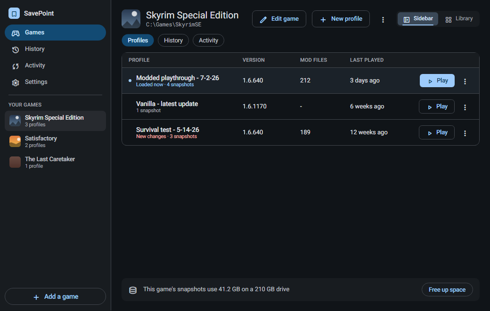
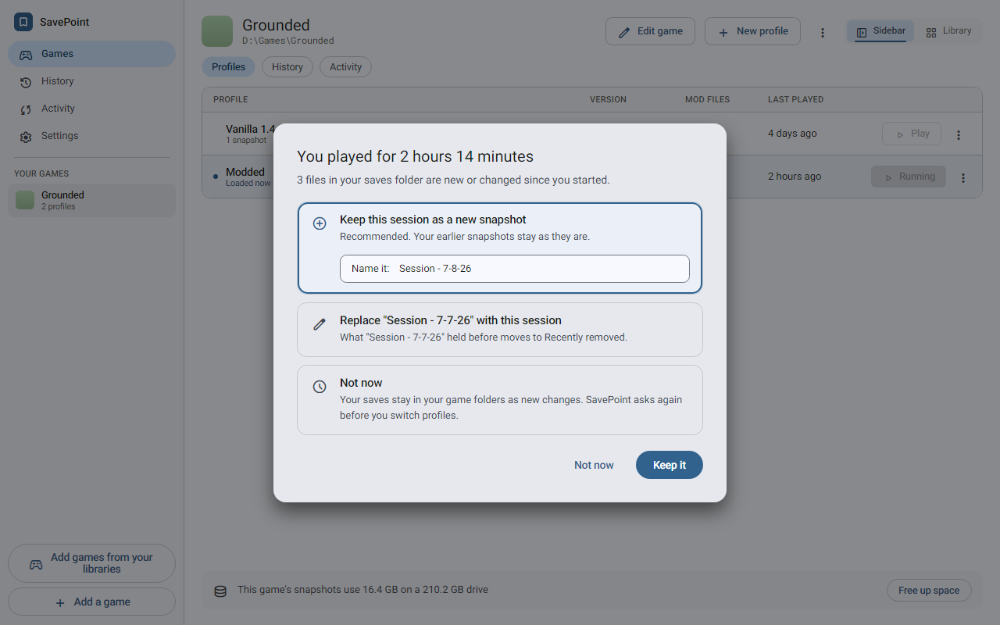
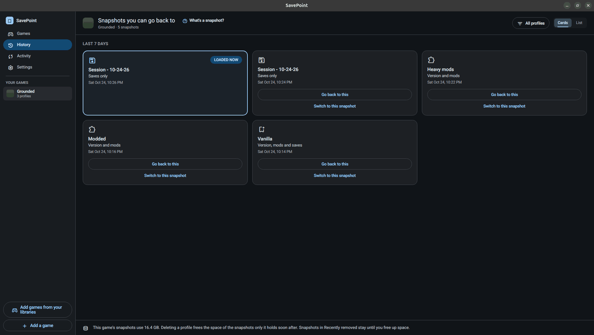

# SavePoint

> **Looking at this on GitHub?** This is a read-only mirror. SavePoint lives at [git.tortal.tech/ethan-hann/SavePoint](https://git.tortal.tech/ethan-hann/SavePoint): downloads are on its [releases page](https://git.tortal.tech/ethan-hann/SavePoint/releases), [issues](https://git.tortal.tech/ethan-hann/SavePoint/issues) and [pull requests](https://git.tortal.tech/ethan-hann/SavePoint/pulls) are there too, and the documentation is at [docs.tortal.tech/SavePoint](https://docs.tortal.tech/SavePoint/). Issues and pull requests opened on GitHub are not seen.

**Quicksave for your whole game folder.**

You spent a weekend getting 140 mods to load in the right order, and the game finally runs right. Then a patch comes down overnight, half the mods break, and your 60-hour save will not load.

SavePoint is the undo button for that morning. It takes snapshots of the game's files and your saves together. Go back to the exact setup that worked, keep a vanilla install and a modded one side by side, or try that one sketchy mod knowing you can take it all back. It works with any game and any mod manager, because it only remembers what was in the folders.

> **Status:** pre-release. Windows and Linux builds work. macOS has not been tried on real hardware yet.



## How it plays

1. **Add a game.** Point SavePoint at the game's folder and its saves folder.
2. **Take a snapshot.** That is your checkpoint: the game version, the mods, and the saves, as they are right now.
3. **Press Play in SavePoint.** It puts the right files in place, starts the game, and waits. When you quit, it asks what to do with the session.



That is the whole loop. Everything else comes from having more than one checkpoint.

## What you can do with it

- **Run vanilla and modded side by side.** Each profile is its own line of play, like "Vanilla 1.5" and "Survival Overhaul 1.6". A switch swaps the files, so you never reinstall anything.
- **Go back after a bad patch.** Pick the snapshot from before the update in History, press **Go back to this**, and play.
- **Try things without worry.** Take a snapshot, install the risky mod, and play. If it goes badly, go back.
- **Split your playthrough.** Sided with the wrong faction? Go back to before the choice and keep the new session as its own profile. Both stories stay playable.
- **Keep the disk in check.** SavePoint stores each file once, so a snapshot that changes a few saves takes very little space. **Free up space** shows what it will delete before it deletes anything.
- **Make it yours.** Light and dark themes, five accent colors, a sidebar or a library layout, and cover art for Steam games. It works fully from the keyboard, with screen readers, and with reduced motion.



You do not need to know anything about version control. Press **F1** for a short illustrated guide, or click a question button like "What's a snapshot?" next to anything new.

## Playing it safe

SavePoint touches only the folders you give it. It refuses a whole drive or a system folder, and it never switches over changes you have not kept. Anything permanent says so and asks a second time. Everything stays on your computer: the only network request is an optional artwork lookup on Steam.

Two things to know before you add a game:

- **Online games with anti-cheat.** Anti-cheat checks the game's own files, and changed or rolled-back files can get your account flagged. Games you can play offline, with anti-cheat turned off for mods, are fine.
- **Cloud saves.** Turn off Steam Cloud or GOG Galaxy sync for any game SavePoint manages, or the two will overwrite each other.

## Install

Grab a package from the latest release:

- **Windows:** run `SavePoint-win-Setup.exe` (it installs for your user and adds a Start menu shortcut), or unzip `SavePoint-win-Portable.zip` anywhere and run `SavePoint.exe`. The packages are not code-signed yet, so SmartScreen asks before the first run.
- **Linux:** run `chmod +x SavePoint.AppImage`, then run the AppImage.
- **macOS:** not packaged yet.

SavePoint never checks for updates on its own. To update, run a newer setup over the old one. Uninstalling keeps your snapshots and settings. To remove those too, use **Settings > Remove all data** before you uninstall.

## Documentation

The [user guide](docs/user-guide.md) covers every screen and action. All the guides and the API reference are published at [docs.tortal.tech/SavePoint](https://docs.tortal.tech/SavePoint/), built from `docs/` and the code on `main`.

For contributors:

- [Developer guide](docs/developer-guide.md): building, testing, gates, and packaging.
- [Architecture](docs/architecture.md) and [Decisions](docs/decisions.md): how it is built and why.
- [UI guide](docs/ui-guide.md): how to build a screen.
- [Testing on macOS and Linux](docs/testing-on-mac-and-linux.md): the gate and the manual checks on a Mac or a Linux desktop.
- [Dogfood checklist](docs/dogfood-checklist.md): the checks that need a person, real hardware, or a real game.
- [AGENTS.md](AGENTS.md): the working rules for every change.

Planned work is tracked in the issues and milestones.

### Under the hood

SavePoint is a native C# app (.NET 10 and Avalonia) that runs on Windows, Linux, and macOS from one build. It stores snapshots with git, the tool programmers use to track code, so snapshots are compact and every file comes back exactly. SavePoint bundles its own pinned copy of git and never uses one installed on your machine. The app never shows you a git word.

To build it, install the .NET 10 SDK (and PowerShell 7 on Windows):

```bash
dotnet build Savepoint.slnx -c Release
```

```bash
dotnet run --project src/Savepoint.App -c Release
```

The first build downloads the pinned git bundle and checks its SHA-256.

## License

SavePoint is free software: you can redistribute it and modify it under the terms of the GNU General Public License as published by the Free Software Foundation, either version 3 of the License, or (at your option) any later version ([LICENSE](LICENSE), SPDX `GPL-3.0-or-later`). It comes with no warranty.

The bundled git is licensed under GPLv2 and runs as a separate program. Its license texts, the other third-party notices, and the source offer ship next to the app ([THIRD-PARTY-NOTICES.md](THIRD-PARTY-NOTICES.md), `licenses/`).
