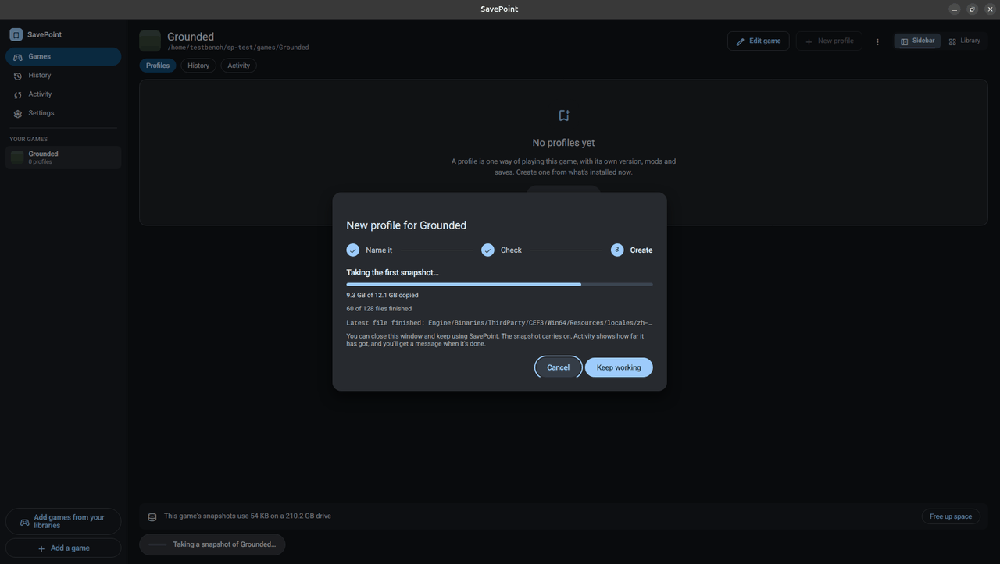
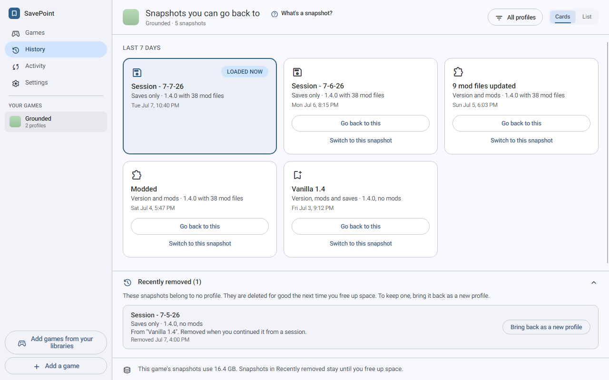

# SavePoint - user guide

SavePoint keeps the setup that works. It takes snapshots of a game's version, mods, and saves, and you can go back to any of them, even after the game updates.

## The idea

- **A game** in SavePoint is the game's install folder, plus the folder its saves live in if you want, and the folder its mods live in for the few games that keep mods somewhere else.
- **A profile** is one way of playing it, like "Vanilla" or "Modded 1.6, survival". Each profile has its own game version, mods, and saves.
- **A snapshot** is a copy of a profile's game version, mods, and saves as they were at one moment. SavePoint takes one when you create a profile and, if you want, every time you finish playing.
- **Saves** are only the files the game writes when you save in the game.

SavePoint keeps snapshots in a folder of its own, the snapshot folder. When you play a profile, it puts that profile's files back into the game's folders, then starts the game.

### Help inside the app

- Press **F1** anywhere, or open **Settings > Help**, for **How SavePoint works**, a short illustrated page. It also explains how a game starts, the files to leave out, cloud saves, online games with anti-cheat and the Steam app ID, and the editor's question buttons link to those parts.
- Question buttons such as **What's a snapshot?** and **What are new changes?** explain an idea where you meet it. Escape closes them.
- After you create your first profile, a four-step tour points out the main controls. Skip it at any step, or press Escape. **Settings > Help > Show the tour again** plays it again.
- The first time you play from an older snapshot, discard changes, or replace a snapshot, SavePoint explains the choice.

## Set up a game

The first time you open SavePoint, it offers **Add your first game** or **Start from a template**. A template fills in the details for a known game, and Add a game offers the same list later. You can also open a game settings file someone else exported. (The pictures in this guide come from Linux. On Windows, only the title bar differs.)

### Add a game

The editor is a column of cards, top to bottom:

1. **Game** (Required):
   - **Name** the game. As you type, SavePoint lists matching games it knows. Pick one (or press Down, then Enter) to fill in the details you have not typed yet. **Pick from the game list** at the top opens the whole list. Any detail you typed stays as you typed it.
   - **Where the game is installed**: pick the game's own folder, for example `C:\Games\SkyrimSE`. SavePoint makes this folder match a profile, which replaces what is inside, so it refuses a whole drive or a system folder.
   - **How to start the game**: run the game's program, or go **Through Steam** with a launch link like `steam://run/489830`. The number is in the address of the game's Steam store page. Steam can update the game right after SavePoint puts your version back, so running the program directly is safer. That warning shows only when you pick Through Steam.
2. **Saves** (Recommended): where the saves live. Many games keep saves outside the install folder, for example under `Documents\My Games`. SavePoint suggests the common spots.
3. **Mods** (Optional):
   - **Mods outside the game folder** is for games that load mods from another folder, such as 7 Days to Die, which keeps them in AppData. Most games keep mods inside the game folder, which SavePoint already takes snapshots of, so leave this empty unless your game keeps them somewhere else. **Does my game keep mods outside its folder?** explains. The 7 Days to Die template fills it in when that folder exists.
   - **Mod files inside the game folder** tells SavePoint which files in the game folder are mods, for the mod counts. **When do I list mod files?** explains. **Choose files...** and **Choose folders...** pick many at once, which is handy for loaders like `version.dll` that sit in the game's main folder. Anything outside the game's folder is left out, and SavePoint says how many.
4. **Artwork** (Optional): see Artwork below.
5. **More settings** starts closed. To change an entry in one of its lists, select it and press Enter, Space, or F2, or double-click it. Enter keeps the change and Escape drops it.
   - **Files to leave out:** SavePoint never copies or replaces a file that matches these rules. Those files never count as changes, and a switch leaves them alone. List only files that do not matter: a rule that matches your saves stops profiles from switching them. The rules are patterns such as `**/*.log`, not regular expressions, and **How do these rules work?** lists what they support. There are two lists:
     - **Files to leave out of the game's own folder.** A new game starts with `**/*.log`, `**/*.dmp` and `**/*.mdmp`, so the logs and crash reports a game writes as it runs are left out. These rules never touch your saves folder, and you can remove them like any rule.
     - **Files to leave out of every folder** applies to your saves and mods folders too.
   - **Extra command-line options.**
   - **Knowing when you've stopped playing:** the name of the game's own program, for launchers that close themselves before the game opens. When a game starts through a link, a note under How to start the game suggests the program to use.
   - **Steam app ID:** SavePoint uses it to find artwork (see Artwork below). It doesn't make SavePoint start the game through Steam or wait for Steam.
6. **Save changes**. SavePoint names every folder it will look after and asks you to confirm each one, because it takes snapshots of everything in it and makes it match the profile when you switch. It adds a small file to each folder so it remembers you picked it. A game's folders can't be the same folder or inside one another.

A game picked from the list may show a short note, such as where its saves are kept.

If a folder you add still has snapshots from a game you removed earlier, SavePoint offers **Reconnect** to bring back its profiles and snapshots, or **Start fresh**.

### Anti-cheat and cloud saves

The editor keeps these behind its question buttons, except a warning when a game's cloud saves are on.

- **Online games with anti-cheat:** SavePoint never touches a game while it is running, but anti-cheat checks the game's own files. Changed or rolled-back files can get your account flagged, and these games cannot be modded or rolled back anyway. Games you can play offline with anti-cheat turned off for mods are fine.
- **Cloud saves:** Steam and GOG Galaxy keep the saves SavePoint changes and upload them when you quit. But they bring back any save SavePoint removed, the next time the game starts, so going back to before a save, or switching to a profile with fewer saves, may not stick. If that matters for a game, turn off its cloud saves in the store. The editor tells you when a game's cloud saves are on. If you play on two PCs and Steam asks which saves to keep, choose **Local Save** to keep the ones SavePoint put back.

### Artwork

Steam games show their cover art. SavePoint looks first in the Steam client's cache on your computer, then on Steam's image servers if **Look up game artwork online** is on in Settings > Appearance. That download is the only network request SavePoint makes. It sends the game's Steam app id and SavePoint's name and version, and nothing that identifies you.

- **Which game it is:** SavePoint reads the Steam app id from a `steam://run/<id>` launch link, a `steam_appid.txt` file in the game folder, or Steam's library files. You can also type it into **Steam app ID** under the editor's More settings. It is the number after `/app/` in the game's Steam store address.
- **Your own image:** **Choose image...** picks one (PNG, JPEG, or WebP, up to 25 MB). Your image always wins, and SavePoint keeps its own copy, so you can move the original. **Remove your image** goes back to the Steam art.
- **When nothing is found:** the game shows a color tint based on its name. **Look again** tries again.

### Change or remove a game

**Edit game** changes any of these settings later. **Export** writes the game's settings to a file you can share, and **Import** loads one. **Delete game** removes the game, its profiles, and all its snapshots from SavePoint, after you type the game's name to confirm. Your game folder, mods folder and saves folder are not touched.

## Take your first snapshot

Your first snapshot comes with your first profile. On the Games screen, **New profile** walks you through three steps:

1. **Name it:** a name and optional notes.
2. **Check:** what goes into the first snapshot from each folder, and how much new space it takes. SavePoint reuses files it already has, so later profiles usually add very little. When the drive is nearly full, SavePoint checks the smaller changed files and doesn't count the ones it already has stored, like a save you put back, so a snapshot made mostly of those is less likely to be refused. Very large files always count in full.
3. **Create:** **Create profile** takes the first snapshot. A big install takes a while the first time. You can close the window and keep using SavePoint. Activity shows progress, and you get a message when it is done.

## Play

Press **Play** or **Switch and play** on a profile, or **Go back and play** on a snapshot in History. Before anything happens, SavePoint shows what it will change:

- **Game version and mods:** what it switches from and to, how much gets replaced or removed, and roughly how long that takes.
- **Saves to load:** the save snapshots you can choose from, newest first. A profile made from another one also offers the saves it started with. The check also says how many files the switch removes from your saves folder.
- **New changes since the last snapshot:** files that changed since the profile's last snapshot. Pick what happens to them before anything switches:
  - **Take a snapshot first** keeps them in the profile they belong to (the dialog names it).
  - **Keep as a new profile** is for changes that belong to no profile, so nothing is lost.
  - **Discard them** asks you to confirm a second time, naming the folder and counting the files it deletes and puts back. This one is permanent.

When a game has a mods folder, SavePoint takes snapshots of it and switches it along with the game folder and saves folder, so each profile keeps its own mods. A mod manager's own files in the mods folder go with the snapshot too. A profile that has never taken a snapshot of the mods folder leaves it as it is when you play.

To skip this check when only your saves would change, tick **Skip this check when only your saves change**. A change to the game version or mods always shows the check.

**Switch and play** puts the files in place and starts the game. While the game runs, SavePoint shows a running card. If SavePoint cannot tell when you have stopped (some launchers hide the game), press **I'm done playing**. If another window is in front when you quit, SavePoint sends a notification so you know it is waiting.

When a game installed in a Steam library (its folder is under `steamapps/common`) is set to run its program and Steam isn't running, SavePoint asks first, before it changes anything. A GOG or other store copy that only has a Steam app ID doesn't count. **Start Steam** starts only Steam, then the game's program once Steam is ready (signed in on Windows, running on Linux and macOS), and you can stop waiting; the waiting card says how long it waits (90 seconds). If Steam can't be started at all, as with some Flatpak or Snap installs, the card says so and asks you to start Steam yourself. **Play without Steam** starts the program as it is, for a game that doesn't need Steam. **Not now** leaves everything as it was. SavePoint doesn't start the game through Steam, because Steam may update the game first and replace the version you picked. If Steam is already updating the game, SavePoint stops before it switches anything and says nothing in your game folders changed. If Steam starts updating it while SavePoint switches your files, SavePoint doesn't start the game and says the update may have changed the game's files.

If the program SavePoint started closes right away with an error, the running card says so and keeps watching for up to two minutes, because some games restart themselves through Steam. On Linux, games installed by Steam usually need Steam to start them, so start Steam first.

### When you finish

SavePoint asks what to do with the session. Each choice is a card: pick one, and the one button at the bottom does what that card says. Escape closes the dialog, the same as Not now. If you pick a choice that keeps the session while the game is still running (or it restarted itself), SavePoint says so and offers **Choose again**. Not now always works.

- **Keep this session as a new snapshot** (recommended). Your earlier snapshots stay as they are.
- **Replace "&lt;snapshot&gt;" with this session.** That snapshot holds this session instead, and what it held before goes to History's **Recently removed**. This choice appears only when the session changed something and started from the profile's own newest snapshot.
- **Not now.** Nothing is lost. Your saves stay in your game folders as new changes, and SavePoint asks again before you switch profiles.

If you played from an older snapshot, the session cannot go on the end of the profile, so your choices are:

- **Keep this session as a new profile** (recommended). The original profile stays as it is, newer snapshots and all. Use this to split a playthrough, for example to replay a choice and keep both stories.
- **Continue "&lt;profile&gt;" from this session**, offered when every folder started the session from that profile's own snapshots. The session becomes the profile's latest snapshot, and its newer snapshots go to History's **Recently removed**.
- **Not now**, as above.

If files in the game's own folder changed while you played, the way an update changes them, SavePoint tells you. It also says when your mods changed. If the only changes are logs or crash reports, it says so and offers **Leave these out from now on**. That adds a rule for the game's own folder, so those files stop counting as changes there.

To never be asked, turn off **Ask whether to keep the session** in Settings. SavePoint then keeps nothing after you play. Your progress stays in your game folders, and SavePoint asks about it before the next switch.

## Go back to an earlier snapshot

**History** shows the snapshots you can go back to, newest first, grouped into the last 7 days and earlier. Each snapshot holds **Version, mods and saves**, **Version and mods**, or **Saves only**. Switch between the **List** and **Cards** views, and filter by profile. History's search also finds a snapshot by its profile or that profile's notes, what it holds, or a date such as `2026-09` or a month name, and you can show only **Saves** or only **Game and mods**. A snapshot in Recently removed is found by the notes of the profile it left. The snapshot your game folders hold right now is marked **Loaded now**. History opens quickly even when a game has thousands of snapshots. Tab reaches every card, and SavePoint keeps your place after a search.

- **Go back and play** on a card, or on a version in the list, puts that whole snapshot back and starts the game. Next to a save snapshot, it puts those saves back in the profile they belong to.
- **Go back without playing** puts the snapshot back and stops there.

Both show the same check as Play.

### Recently removed

**Recently removed** lists the snapshots that "Replace" or "Continue" took off a profile, and a long list scrolls in its own area. Each one stays until the next time you free up space. **Bring back as a new profile** starts a profile from it and leaves the profile it came from as it is.

## Manage profiles

The profile table on the Games screen shows each profile's snapshot count, notes, game version, mod files, and when you last played it. **Loaded now** means its files are in your game folders. **New changes** means files changed since its last snapshot. It shows up within a second or so of a change in the game's folders, without leaving the screen, and waits while a snapshot, switch, or game session runs. It also pauses while the SavePoint window isn't in front, and SavePoint checks again when you come back to it.

The loaded profile has **Play**. Every other profile has **Switch and play**, which loads it first. With a row selected, Enter does the same. **Take a snapshot**, next to the tabs, keeps what your game folders hold right now as a new snapshot of the loaded profile. A profile with no snapshot yet gets its first one this way.

The row's menu has **Edit** (name, notes, version), **Take a snapshot**, **Duplicate**, **Open game folder**, **Open mods folder**, **Open saves folder**, and **Delete**. Open it with the row's More actions button, by right-clicking the row, or with the Menu key or Shift+F10 on a selected row:
- **Duplicate** starts a new profile with the same game version and mods, but no save snapshots of its own.
- **Open game folder**, **Open mods folder** and **Open saves folder** open that folder in your file manager as it is right now, so it may hold another profile's files, not the files of the profile you picked. Open mods folder and Open saves folder appear only when the game has that folder. If the folder moved or is gone, SavePoint says so instead.
- **Delete** warns you when the profile has snapshots no other profile has, and says what happens to them. Usually they are deleted for good. Snapshots that came from Recently removed, as in a profile you brought back from there, go back to Recently removed instead.

**New profile** works the same way as your first one (see Take your first snapshot). On its first step you can tick **Start with no saves** and, when the game has a mods folder, **Start with no mods**, to try a fresh setup. A box is off, with the reason, until that folder's current files are in a snapshot of one of the game's profiles, so nothing is lost. A box is also off, and says so, when SavePoint can't check that folder's files right now, because a file is open in another program or can't be read. Closing the program that holds the file and trying again helps, but a snapshot does not. If you deleted the folder and made it again by hand, confirm it in Edit game before you make the profile, because that box stays off until you do. Nothing on disk changes when the profile is made. The next time you switch to it, SavePoint asks before it empties that folder and says how much it will remove. The game folder can't start empty.

The games list, a game's profile table, and its History each have a search box. Type any words from a name or a profile's notes. Initials work too, as in "skyrim se", and accents and punctuation don't matter. Add a game's **Name** field and the template list match games the same way. Ctrl+F (Cmd+F on a Mac) jumps to the search on the screen in front, which on the Games screen is the profile search. Ctrl+Shift+F (Cmd+Shift+F) jumps to the games list search from anywhere. Hover over a search box to see its key. When nothing matches, **Clear search** under the message clears it and puts you back in the box, and Escape in the box clears it too. While a search narrows the profile table, its header says how many profiles show. The profile search stays above the profile table when there is room, and scrolls with the profiles when the window is short. The narrow icon list of games has no search box.

## Activity

**Activity** lists the selected game's running and recent tasks: snapshots, switches, and freeing up space. **All games** adds snapshot folder moves and data removal. Open it from the task status indicator, or from the game's **Activity** tab in the Sidebar layout.

Each task shows its profile, its progress, and when it started and finished. A finished task reads in the past tense, such as "Took a snapshot of ...". **Details** lists the files and steps, which you can copy into a bug report. While a big snapshot runs, "Probably copying" names the file SavePoint thinks it is on. **Cancel** stops a task that can be stopped, or tells you it cannot stop now.

Finished tasks stay listed after you close SavePoint: the newest 100, for up to 30 days, and up to five per game. A task from before SavePoint last closed keeps its title and result, but not its steps. **Remove all data** also clears the list.

Right after a snapshot, SavePoint may run "Compacting snapshot files for &lt;game&gt;". It packs the stored snapshot files tighter on disk and deletes nothing, so it is not Free up space. If you play the game or take a snapshot of it meanwhile, compacting stops to let that go first, and Activity says it was stopped, not canceled. Free up space stops the same way when you start the game, until it begins deleting.

## Free up space

Snapshots no profile uses anymore, like a deleted profile's, still take up space, and so do the ones in Recently removed. **Free up space** deletes them, the mods folder's snapshots included. When it would delete snapshots from Recently removed, it asks first and tells you how many, and about how much space it frees once that is ready. When it starts to delete, it cannot be stopped, and quitting waits for it to finish.

You find **Free up space** in three places:

- **Settings**, under Free up space, with a **Free up space** button. Before you press it, a line says how many snapshots in Recently removed it will delete for good, or that Recently removed is empty. Once SavePoint has worked it out, the line also says about how much space comes back, such as "about 1.2 GB".
- The footer under the profile table in the Sidebar layout, which also shows how much space this game's snapshots use and how big the drive is.
- The game's menu in the Library layout.

A smaller cleanup also runs on its own after you delete a profile. It leaves Recently removed alone.

To put the snapshots on another drive, use **Change** under **Where SavePoint keeps your snapshots** in Settings. SavePoint copies everything, checks every file, switches over, and then removes its old copy.

## Settings

Help, the snapshot folder, and Free up space are covered above. The other settings:

- **Appearance:**
  - theme: light, dark, or match the system;
  - accent color: blue, violet, green, amber, or crimson;
  - layout: **Sidebar** keeps every game one click away, and **Library** puts the cover art up front. In Sidebar, only the list of games scrolls. In Library, the game cards wrap to fit the window. You can also switch layouts from the Games screen;
  - interface size: 100%, 125%, 150%, 175%, or 200%, which makes everything in SavePoint larger on top of your screen's own scaling. Sizes that do not fit on the current screen are switched off, with the reason. A size you picked on a big screen shows smaller on a screen that cannot fit it, and comes back on the big screen;
  - **Look up game artwork online**.
- **Before you play:** **Skip the check before playing when only your saves change**. A switch that would empty a folder always asks.
- **When you finish playing:** **Ask whether to keep the session**.
- **Apps menu (Linux AppImage only):** "Add SavePoint to your apps menu" puts SavePoint and its icon in your apps menu, so you can pin it to the dock. "Remove SavePoint from your apps menu" takes it away. If you move the AppImage, the entry says it is out of date, and **Update** points it at the new place.
- **Remove all data:** deletes every snapshot (the mods folder's too), SavePoint's settings, game list, artwork, and logs (except today's open log file), and its small file in each game folder. You cannot go back to any earlier version, mods, or saves after that. Your game folders and everything in them stay as they are. You confirm by typing a word.
- **About:** the version, the third-party notices, and **Open the log folder**.

Apart from the game folders you pick, SavePoint writes only to its own folders. These are the default locations, until you move them:

| | Settings and game list | Snapshot folder |
| --- | --- | --- |
| Windows | `%APPDATA%\SavePoint` | `%LOCALAPPDATA%\SavePoint Data\Storage` |
| macOS | `~/Library/Application Support/SavePoint` | `~/Library/Application Support/SavePoint/Storage` |
| Linux | `~/.config/savepoint` | `~/.local/share/savepoint/storage` |

## When something goes wrong

Every error says what happened and what you can do about it. **Show details** gives you the technical text. The common ones:

- **A file is in use.** Another program has a file open, so a switch or a snapshot stopped or did not start. Close that program (usually the game, its launcher, or a mod manager) and try again. A retry picks up where it stopped. "Replace" also needs every file closed, even unchanged ones.
- **SavePoint can't read a file.** A file in a game folder cannot be opened, usually because it belongs to another account or is marked private. Closing programs does not help. Make the file readable for your account, or remove it, then try again.
- **A file and a folder share a name.** A profile needs a file where your game folder has a folder with that name (or the other way around), and that folder holds files SavePoint must not touch, such as files you left out. SavePoint stops before changing anything and tells you which one. Move it yourself, then try again.
- **A file in the game is a link.** On Windows, a game folder holds a file that is a link to a file kept somewhere else, like the ones a mod manager makes when it deploys mods as links. SavePoint cannot take a snapshot of that file or switch it, because Windows would put a plain file back and the mod would stop loading. Switch the mod manager to hardlink or move deployment, replace a link you made yourself with the real file, or leave that file out of snapshots in Edit game. Discarding changes and removing new files still work.
- **This snapshot can't be put back on Windows.** You chose a snapshot that was taken while a program had linked files into one of the game's folders. Nothing changes; choose a different snapshot or profile. Linux and macOS are not affected by either of these.
- **Only part of the snapshot was taken.** One folder made it into the snapshot and the other did not. Fix the reason shown and retry just that part. Nothing already kept is affected.
- **The last switch didn't finish.** The folder has a mix of files from two snapshots. Finish the switch to carry on, or discard the changes to put the folder back to its last snapshot. Finishing replaces the files the switch was changing, including any change you made since it stopped, and SavePoint says how many (and which saves) first. If other files changed meanwhile, or SavePoint can't tell which switch it was, only discarding is offered.
- **SavePoint's record of this game's folder is damaged.** This usually follows a power cut or a crash. SavePoint repairs its record by itself when it can, and your game files are not changed either way. If this message keeps coming back, include **Copy details for support** in a bug report.
- **The folder changed while SavePoint worked.** Something replaced or moved the game folder during a switch or discard, so SavePoint stopped before changing more files. Make sure nothing else is moving the folder, then try again.
- **A folder moved or is gone.** SavePoint still has every snapshot. Point it at the new location to carry on.
- **That folder may be the wrong one.** The new folder you picked for a game holds fewer than half the files its snapshots have, as when you pick the parent folder by mistake. Check the counts, then confirm or pick again.
- **SavePoint can't reach your snapshots.** The snapshot folder cannot be reached at startup. SavePoint offers three ways forward:
  - **Try again**, after you connect the drive or network share.
  - **Find the folder**, when the folder moved or the drive has a new letter. SavePoint checks that the folder you pick holds its snapshots. Any game that folder has no snapshots for starts over with its next snapshot.
  - **Start with an empty folder**, when the old folder is gone for good. You confirm first. Your games and profiles stay listed, but their old snapshots stay behind, and each profile starts over with its next snapshot.
- **Part of that session isn't in the snapshot.** You played from a snapshot that left one folder as it was, because that folder belongs to another profile. SavePoint keeps the folder that is yours. The other folder's changes stay in your game folder. When nothing could be kept, the card says **SavePoint couldn't take a snapshot of that session**.
- **Some old copies couldn't be removed.** After a snapshot folder move, SavePoint lists the old files it could not delete. Delete them by hand.
- **An unreadable settings file at startup.** For each file, SavePoint offers to restore the last good copy or start that file empty. It moves the unreadable file aside and never deletes it.

If you close SavePoint while it removes all data or moves the snapshot folder, it asks first, because stopping either one halfway leaves a mess. If you close it while it takes a snapshot, it asks too: closing stops the snapshot and keeps nothing of it. Choose **Minimize** to let it finish in the background.

### Reporting a problem

SavePoint keeps a log of what it did and every error, one file per day, and keeps the newest 14. **Settings > About > Open the log folder** takes you there. When you report a problem, send the log from the day it happened. It has folder paths and game names from your computer in it, and SavePoint never sends it anywhere.

| | Log folder |
| --- | --- |
| Windows | `%LOCALAPPDATA%\SavePoint Data\Logs` |
| macOS | `~/Library/Logs/SavePoint` |
| Linux | `~/.local/state/savepoint/logs` |

If SavePoint hits a problem it cannot recover from, it shows one last window with the details and the log folder, then closes. It never keeps going in an unknown state that could touch your game folders.
